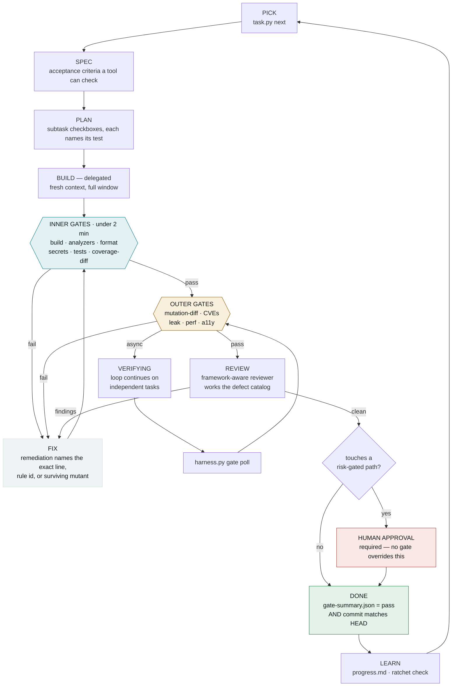
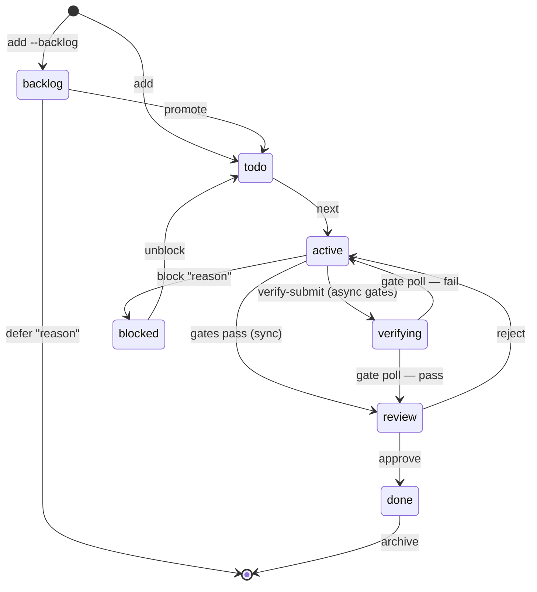
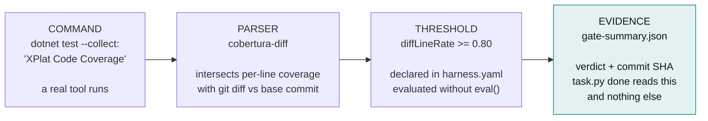
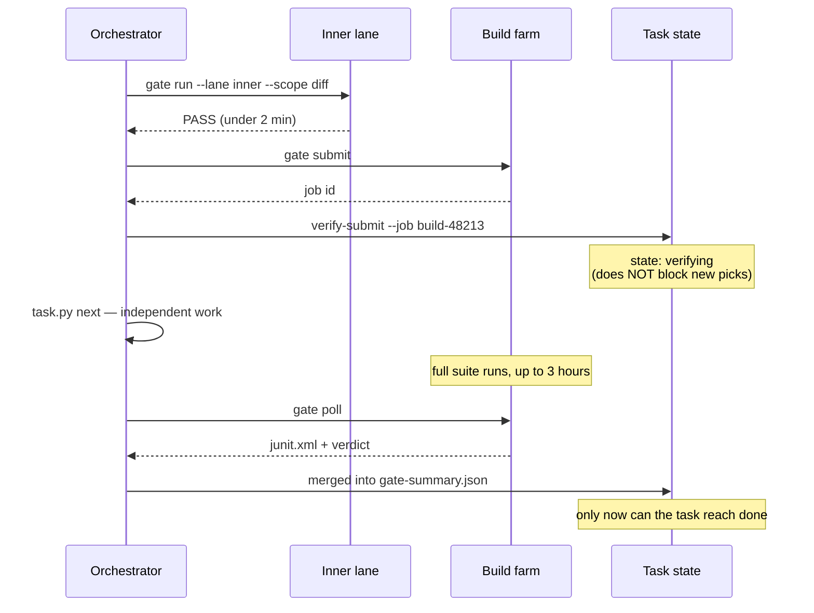

# Evidence Over Assertion

**Agent harness — design rationale**

> For any claim where a deterministic tool exists, the agent may not assert the\
> conclusion. It must run the tool of record and cite the evidence.

An agent can say "no memory leaks here" with total fluency and zero information —\
leak detection requires observing heap state over time, which is not in the source.\
A profiler cannot. This harness routes every claim of that kind to a tool, and\
refuses to record a verdict no tool produced.

```plaintext
$ python3 .agent/tools/task.py done

REFUSED: cannot mark T-014 done without passing gate evidence.
  0/1 gates pass, 1 not run

This is the harness working as designed: a task is done when
tools say so, not when an agent says so. Run:
  python3 .agent/tools/harness.py gate run
Override (logged to journal): --override "reason"
```

**9** stack profiles · **57** gate definitions · **15** evidence parsers · **4** maturity tiers\
React · Angular · Blazor · MAUI · WinForms · ASP.NET Core · Python

---

## The problem

### A process ritual is not a harness

Most agent harnesses are a task list plus a sequence of stages, where every quality\
gate resolves to *the agent reads a checklist and forms an opinion*. That is an LLM\
judging LLM output. It produces claims that are confident, well-written, and\
unverifiable.

The failure is not that agents are careless. It is that the questions we ask them are\
frequently unanswerable from the source they are reading. "Are these tests thorough?"\
cannot be settled by looking at test code; it is settled by mutating the\
implementation and seeing whether the tests notice. "Does this leak?" cannot be\
settled by reading a component; it is settled by taking two heap snapshots. The\
harness's job is to route each question to the thing that can actually answer it.

---

## The loop

Every task runs the same cycle. The orchestrator delegates BUILD to a fresh context\
so it never fills its own, and delegates REVIEW so the reviewer is not biased by\
having written the code — but the load-bearing component is neither. It is the gate\
runner.



### Task states



| State | Blocks new picks? | Meaning |
| --- | --- | --- |
| `backlog` | no | Not eligible. Must be promoted or explicitly deferred with a reason. |
| `todo` | no | Ready, dependencies met. |
| `active` | **yes** (`maxActive`) | A build agent is working. |
| `verifying` | **no** (capped by `maxVerifying`) | Async outer gates in flight — the loop moves on. |
| `review` | yes | Gates passed, awaiting review sign-off. |
| `blocked` | no | Needs external action; reason recorded. |
| `done` | no | Passing evidence at the current commit. |

`verifying` is the state that makes hours-long cloud suites workable: the only\
non-terminal state that does not block progress — and it is **not** `done`.

---

## The mechanism

### Every gate is four parts

A gate runs a real command, a parser extracts a number from the real output, the\
harness compares that number to a declared threshold, and the result is written to an\
evidence file. The agent's narrative never enters the chain.



The commit SHA matters as much as the verdict: evidence goes stale the moment new code\
lands, so an agent cannot run gates early and keep committing afterwards.

### What it looks like when it catches something

An agent added a function and a test that only checks the code doesn't crash — the\
signature failure mode of AI-written tests. Coverage is the gate that notices, and it\
names the exact lines.

```plaintext
GATES  task=T-001  lane=inner  scope=diff  base=2efe5815

  FAIL coverage-diff            diffLineRate=0.4444  [0.4s]
       Add tests covering these changed lines (they are yours, not legacy):
           src/calc.py:12
           src/calc.py:16
           src/calc.py:17

  0/1 gates pass, 1 not run  [0.4s total]
  evidence -> .agent/evidence/T-001/gate-summary.json
  VERDICT: FAIL

  task.py will refuse to mark this task done. That is the design.
```

---

## Tools of record

### The claims nobody may assert

Each row is a question an agent will otherwise answer from vibes. The right-hand\
column is what actually settles it. `harness.py explain "<claim>"` resolves any claim\
to its gate — and **exits non-zero when no gate covers it**, which is the signal to\
record the claim as `UNVERIFIED` rather than assert it.

| Never LLM-asserted | Tool of record | Licence | Evidence |
| --- | --- | --- | --- |
| "tests pass" | test runner | MIT | `junit.xml` / `*.trx` |
| "my changes are tested" | coverage, **diff-scoped** | MIT / Apache-2.0 | `cobertura.xml` + git diff |
| "the tests are meaningful" | Stryker.NET / StrykerJS `--since` | Apache-2.0 | `mutation-report.json` |
| "no memory leak" | dotnet-gcdump · memlab | MIT | heap delta / `leaks.json` |
| "code quality is good" | Roslyn NetAnalyzers · ESLint | MIT | build diagnostics |
| "this is secure" | Semgrep OSS · Gitleaks | LGPL-2.1 · MIT | `*.sarif` |
| "no vulnerable dependencies" | OSV-Scanner · `dotnet list package` | Apache-2.0 | `osv.sarif` |
| "no performance regression" | BenchmarkDotNet · Lighthouse CI | MIT · Apache-2.0 | `bench.json` |
| "accessible" | axe-core | MPL-2.0 | axe results |
| "no breaking API change" | PublicApiAnalyzers · api-extractor | MIT | RS0016 / RS0017 |
| "architecture boundaries hold" | ArchUnitNET · dependency-cruiser | Apache-2.0 · MIT | test report |

### Licence policy

Every tool is free for **commercial closed-source** use. Copyleft appears only where\
the tool is a standalone executable analysing your code — that use imposes nothing on\
your source. Each gate carries a `licence:` field, so `harness.py doctor` prints the\
licence posture on demand.

**Deliberately excluded**, with the free substitute:

| Commonly recommended | Problem | Use instead |
| --- | --- | --- |
| CodeQL | Free only for open source; commercial needs paid GitHub Advanced Security | **Semgrep OSS** |
| dotMemory / dotTrace / ReSharper CLI | Commercial JetBrains licence | **dotnet-gcdump / dotnet-counters** (MIT, Microsoft) |
| SonarQube Developer+ | Paid | **SonarQube Community Build** + free `SonarAnalyzer.*` NuGet |
| Percy / Chromatic / Applitools | Paid SaaS | **Playwright** `toHaveScreenshot()` |
| Snyk | Capped free tier | **OSV-Scanner** or **Trivy** |
| NDepend | Commercial | **ArchUnitNET** + `dotnet list reference` |

---

## Tiers

### Start where the project actually is

Teams abandon harnesses that demand a standard they cannot meet on day one. A tier is\
a *claim about what has been verified* — so `harness.py validate` **fails** when a\
declared tier's obligations are unmet. It cannot be aspirational.

| Tier | Name | Adds | Promise |
| --- | --- | --- | --- |
| **L0** | Unverified | build, analyzers, secrets | **Nothing is promised about behaviour.** Every task is stamped `UNVERIFIED` and must add characterization tests for what it touches — which converts L0 into L1 as a side effect of normal feature work. |
| **L1** | Diff-verified | \+ test execution, **diff coverage** | Changed lines are tested; legacy code is not held to a bar it could never meet. |
| **L2** | Verified | \+ full-suite green, dependency CVEs, global coverage floor | The whole project, not just the diff. |
| **L3** | Hardened | \+ **diff-scoped mutation**, leak / perf / a11y budgets, architecture rules | Tests are meaningful, not merely present. |

### Why diff coverage, not global

Global coverage on a fifteen-year-old WinForms codebase is 4%. Set a threshold there\
and it is either unreachable or meaningless — so the gate gets disabled. Diff coverage\
asks an answerable question: *of the lines this task changed, how many are covered?*\
That is enforceable at 80% on any codebase from day one.

```plaintext
GLOBAL COVERAGE
▓░░░░░░░░░░░░░░░░░░░░░░░░░░░░░░░░░░░░░░░   4%   unenforceable · demoralizing · gamed

DIFF COVERAGE
▓▓▓▓▓▓▓▓▓▓▓▓▓▓▓▓▓▓▓▓▓▓▓▓▓▓▓▓▓▓▓▓░░░░░░░░  80%   enforceable today, on any codebase
```

### The ratchet

A threshold that can move down is not a threshold. Gates marked `ratchet: true` record\
a floor in `harness.lock`, and lowering one fails validation in CI.

This matters more with agents than with people. An agent told to *make the gates pass*\
will discover that editing the threshold is the cheapest available path.

```plaintext
$ harness.py validate

FAIL  gate 'coverage-diff': threshold diffLineRate >= 0.3 is below the ratchet
      floor diffLineRate >= 0.8 recorded in harness.lock. Quality bars ratchet
      up, not down.
```

`harness.py ratchet` works the other way — proposing raises where the project already\
clears the bar comfortably.

---

## Two lanes

### When the suite runs for three hours

Verification splits by feedback latency, not by kind. A slow inner lane is how agents —\
and people — learn to batch work and skip checks, so `harness.py` warns whenever a\
lane exceeds its declared budget.

| Lane | Budget | Contents | When |
| --- | --- | --- | --- |
| **inner** | **< 2 min** | build, analyzers, typecheck, *impacted* unit tests, diff coverage | after every subtask |
| **outer** | minutes to hours | full suite, E2E, mutation, leak/perf, cloud runs | once per task |



**Integration surface: two scripts.** A **submit** that prints a job id, and a **poll**\
that **exits 75** while still running. Azure DevOps, Jenkins, GitHub Actions, TeamCity\
or an internal farm are all details of those two scripts.

**Test impact selection** is what makes an inner lane possible at all on a large repo.\
Start at project granularity — map changed files to their owning project via the\
solution graph or workspace graph. Typically an 80% cut for near-zero effort.

**Flaky tests:** quarantined tests still run and are still recorded — they are excluded\
only from the blocking threshold, and an entry older than its expiry becomes a\
validation error. A retry that is recorded is data; a retry that is hidden is how a\
suite rots.

---

## Vendor-neutral

### One protocol, every agent tool

The protocol names abstract capabilities — `DELEGATE`, `READ_FILE`, `RUN` — and a small\
adapter binds them to each host. The root pointer files are twelve lines and contain\
**no protocol content**, so they cannot drift out of sync with each other.

```plaintext
.agent/                     canonical · committed · host-agnostic
├── harness.yaml            the contract
├── harness.lock            resolved tools, ratchet floors, repo fingerprint
├── instructions.md         the protocol
├── project-context.md      architecture map from real tooling, not inference
├── tools/                    task.py · harness.py · parsers.py · hyaml.py
├── adapters/               codestudio.md · claude-code.md · generic.md
├── knowledge/              cited framework rules, hashed in the lock
├── agents/reviewer.md      framework-aware, works a defect catalog
├── tasks/                  index.json + journal.jsonl (append-only audit)
└── evidence/               gate output — the only gitignored path

.codestudio/codestudio-instructions.md   pointer
CLAUDE.md                                 pointer
AGENTS.md                                 pointer — Codex, Cursor, Copilot
```

Everything except `evidence/` is committed. A harness that lives on one developer's\
machine is not a harness — CI has to run `harness.py validate` against the same\
contract the agent used.

---

## Syncfusion overlay

### The vendor already published the rule

Syncfusion maintains an official agent registry at [ai.syncfusion.com](https://ai.syncfusion.com)\
— an onboarding skill, 775 component skills across 18 platforms, and per-platform MCP\
servers. Their first instruction is **"Do not write Syncfusion code from memory"**,\
which is this harness's principle stated by the people who own the API.

An overlay composes onto any profile, so the same file serves the Angular, React,\
Blazor, MAUI and WinForms teams without forking anything.

### Install narrow, not wide

Syncfusion is explicit that agents should not load whole packs into context. The Blazor\
pack alone is 72 skills — context the build agent pays for on every delegation and\
mostly cannot use.

`detect-syncfusion-components.sh` greps for components actually in use. On a real\
Blazor project: **5 skills instead of 72.**

### Resolve identifiers, never construct them

Skill names do not follow from component names as reliably as they appear to. Measured\
against the live inventory, naive construction got **half a four-component sample\
wrong**. So the detector fetches `inventory.txt` and resolves against the `skill_name`\
column — an unmatched candidate is reported, never installed on a guess.

| In code | Constructed by pattern | Actual `skill_name` |
| --- | --- | --- |
| `SfGrid` | `syncfusion-blazor-datagrid` | ✅ `syncfusion-blazor-datagrid` |
| `SfPdfViewer2` | `syncfusion-blazor-pdf-viewer` | ✅ `syncfusion-blazor-pdf-viewer` |
| `SfChart` | `syncfusion-blazor-chart` | ❌ `syncfusion-blazor-charts` |
| `SfSchedule` | `syncfusion-blazor-schedule` | ❌ `syncfusion-blazor-scheduler` |
| `ExcelEngine` | `syncfusion-document-sdk-excel` | ❌ `syncfusion-dotnet-excel` |

### Four gates, all from Syncfusion's own mandatory rules

Every one of these fails **silently** in a normal build and test run. That is precisely\
why they are gates rather than review checklist items.

| Gate | Catches |
| --- | --- |
| `syncfusion-license` | Registration missing, or after the first component is created. Key as a string literal. Key inside a WebAssembly project, where it ships to every visitor. |
| `syncfusion-banner-suppression` | A licensing banner hidden with `display:none`, removed from the DOM, or a swallowed licensing exception. An agent told "remove the trial banner" reaches for exactly these. |
| `syncfusion-blazor-setup` | Missing `AddSyncfusionBlazor()` — components render **empty with no error**. Missing theme stylesheet — unstyled. Missing render mode on .NET 8+ — events bind but **never fire**. |
| `syncfusion-version-consistency` | Mixed package versions — unsupported, and produces `MissingMethodException` that presents as an application bug and costs days. |

### MCP, without handling the key

The harness writes config referencing `~/.syncfusion/api-key.txt` and **never writes the\
key itself**. Environment variable casing is exact: `Syncfusion_API_Key_Path` — all-caps\
`SYNCFUSION_API_KEY` is invalid. An MCP API key is not a product licence key; both are\
required. With no key file present, the harness records MCP as\
`configured-but-unauthenticated` rather than claiming the server is live.

---

## Anti-gaming

### Name the cheat, block the mechanical ones

Agents optimise for the stated objective. None of these countermeasures is airtight\
against a determined adversary; all of them are airtight against an agent taking the\
cheapest available path — which is the actual threat.

| Cheat | Countermeasure |
| --- | --- |
| Lower the threshold | Ratchet floor in the lock; `validate` fails in CI |
| Delete or skip the failing test | Test-count metric; the reviewer inspects the diff for removals |
| Assert nothing — `assert x is not None` | Mutation gate: the mutant survives and the score drops |
| Cover the lines without asserting | Diff coverage passes, mutation catches it — this is why L3 exists |
| Add a coverage-exclusion attribute | Counted as a gate metric and flagged in review |
| Suppress the analyzer inline | Suppressions added in a diff require a written justification |
| Override the gate | Requires a reason; written permanently to `journal.jsonl` |
| Hand-edit `index.json` | `task.py doctor` detects it; the journal has no matching event |

---

## Review

### The reviewer does not repeat the gates

A reviewer that restates gate conclusions wastes the review on settled facts and\
eventually *contradicts* one — at which point the team must decide which to believe,\
and the value of both drops to zero. The division is clean.

| Gates decide facts | The reviewer handles judgement |
| --- | --- |
| Does it compile, do tests pass, is the diff covered, do mutants survive, does the heap grow, are there CVEs. | Is this the right abstraction, does it match the spec, is the error handling coherent, is the boundary respected, is a catalogued framework defect present. |

Each profile ships a defect catalog where every entry is paired with the analyzer rule\
that catches it. That produces the reviewer's single most valuable behaviour: **when a\
rule exists but is not enabled, the finding is the missing configuration.** One config\
change prevents the class forever; fifty review comments fix fifty instances and\
prevent nothing.

### Every finding carries a Verify line

```plaintext
[A1] Subscription never unsubscribed
  File:   src/app/orders/order-list.component.ts:47
  Rule:   rxjs-angular/prefer-takeuntil  (NOT ENABLED)
  Why:    updates$ is subscribed in ngOnInit with no teardown. The service is
          providedIn:'root', so every navigation leaks the component and its
          entire template subtree.
  Fix:    updates$.pipe(takeUntilDestroyed(this.destroyRef)).subscribe(...)
  Config: enable the rule as 'error' — prevents the class, not the instance
  Verify: PARTIAL. The lint rule confirms the pattern is gone. Confirming the
          leak is fixed needs the memlab gate, which is not configured here.
```

The `Verify` line is mandatory. It is what stops the reviewer becoming another source\
of confident, unverified assertions — and a finding it cannot verify is itself a\
candidate for a new gate.

---

## Getting started

### Detect, propose, then write

The skill scans the repository and **proposes before writing anything**: the detection\
evidence, a diagram of the loop tailored to your stack, the gate table with licences\
and estimated lane times, the gates deliberately *not* proposed with their cost and\
rationale, and the exact file list. Nothing lands until you approve it.

Naming what is not proposed is the teaching surface — it is how a team learns that\
mutation testing exists and what it would cost them.

```bash
# in any repo — scans, proposes, waits for approval
"set up harness"   or   "evaluate my harness"

# then
python3 .agent/tools/harness.py doctor      # tools, drift, knowledge citations
python3 .agent/tools/harness.py tier        # current tier, next-tier requirements
python3 .agent/tools/harness.py gate list   # every gate, threshold, metric
python3 .agent/tools/harness.py explain "no memory leak"
python3 .agent/tools/task.py next
```

`explain` exiting non-zero is meaningful, not an error: no gate covers that claim, so\
the agent must record it as `UNVERIFIED` rather than assert it.

---

*Agent harness design rationale · 9 profiles, 57 gate definitions, 15 evidence parsers ·\
every recommended tool free for commercial closed-source use.*

*The whole system reduces to one sentence: a task is done when tools say so, not when\
an agent says so.*