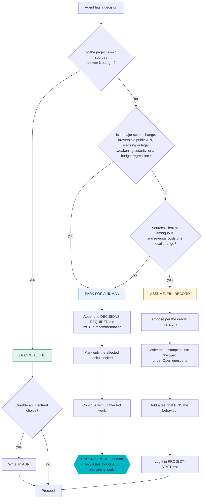

# The Autonomy Boundary

An autonomous loop needs an answer to *what may the agent decide by itself?* Without
one you get the two failure modes that kill these systems: an agent that stops and
asks about everything, or an agent that quietly makes an irreversible product
decision at 2am.

Three lanes, one prime directive.

> **PRIME DIRECTIVE: never block the whole project on a single question.** Park the
> question, mark the affected tasks blocked, and take the next ready task. A human
> checkpoint fires only when a parked decision blocks *every* remaining task.

## The three lanes



### Lane 1 — DECIDE ALONE

Internal design, naming, algorithms, data structures, test structure, refactors that
do not change a public signature, dependencies already permitted by policy.

The test is reversibility plus locality: if it is wrong, does fixing it touch one
module and no consumer? Then decide, and move.

Record an ADR when the choice is durable — something a future maintainer would
otherwise re-litigate. Not every decision earns an ADR; a directory of forty ADRs
about variable naming is as useless as none at all.

### Lane 2 — ASSUME, PIN, RECORD

The sources are silent or ambiguous, but being wrong costs one local change. Guessing
silently is the failure here — not guessing.

Four steps, all four required:

1. **Choose** per the oracle hierarchy in `references/oracles.md`.
2. **Write the assumption into the spec** under *Open questions* — so the next person
   sees a decision, not an accident.
3. **Add a test that pins the behaviour.** This is the step that gets skipped and the
   one that matters: the pin is what converts an assumption into something a future
   change cannot silently violate.
4. **Log it** in `PROJECT-STATE.md` under *Open decisions*.

### Lane 3 — PARK FOR A HUMAN

Five categories, and they are deliberately narrow:

| Category | Example |
|---|---|
| Major scope change | "this feature needs a new service" |
| Irreversible public API | a breaking signature change in a shipped library |
| Licensing or legal | adding a copyleft dependency; a licence-key handling change |
| Weakening security | relaxing authz, disabling cert validation, broadening CORS |
| Budget regression above threshold | bundle, latency, or memory past its declared budget |

Parking is not stopping. It is: append to `DECISIONS-REQUIRED.md` **with a
recommendation and the trade-off**, mark only the affected tasks blocked, and take
the next ready task.

The recommendation is mandatory. A parked question with no recommendation transfers
all the work back to the human and wastes the analysis the agent already did.

## The three human checkpoints

Exactly three. Every other decision belongs in lane 1 or 2.

| # | Checkpoint | Fires |
|---|---|---|
| **1** | **Scope approval** | Once, at the end of `project-bootstrap`, before the roadmap is frozen. |
| **2** | **Blocking decision** | Only when parked decisions block *every* remaining ready task. |
| **3** | **Release GO / NO-GO** | Before any publish, tag, or deploy. |

Phase transitions in between are **automatic** — a milestone report is written and
the loop advances. Requiring sign-off per phase reintroduces the human as a
bottleneck, which is the thing the harness exists to remove.

## Bounded retry

```
Attempt 1  →  hypothesis A
Attempt 2  →  hypothesis B   ← must be SUBSTANTIVELY DIFFERENT, not a tweak
Attempt 3  →  hypothesis C
              ↓
         escalation workflow, once
              ↓
    task blocked with failing evidence attached  →  next ready task
```

The constraint doing the work is *substantively different*. Three attempts at the
same idea with small variations is one attempt, and is the characteristic failure of
an agent that has run out of ideas but not out of budget. The escalation workflow
requires stating what changed between hypotheses.

## The one rule with no exceptions

> **NEVER disable, weaken, skip, narrow, or delete a test, gate, assertion, threshold
> or policy in order to make a gate pass.**

This is the rule the whole system rests on, because it is the cheapest available path
for an agent under instruction to make things green. Enforcement is layered:

| Layer | Mechanism |
|---|---|
| Thresholds | ratchet floor in `harness.lock`; `validate` fails in CI |
| Control plane | SHA-256 in `HARNESS-LOCK.json`; `verify` fails in the gate |
| Tests | mutation gate; the reviewer inspects the diff for removals and skips |
| Suppressions | `check-suppressions.sh` requires a written justification |
| Overrides | `--override` needs a reason and is written to `journal.jsonl` |

## Writing this into the harness

The generator emits `.agent/policies/autonomy-boundary.md` with the three lanes
resolved for the project — the park categories are populated from the detected
`risk.requiresHumanApproval` globs, so the boundary and the risk gate cannot
disagree. It also creates `DECISIONS-REQUIRED.md` with its header, because a parking
lot that does not exist yet is a parking lot the agent will not use.
