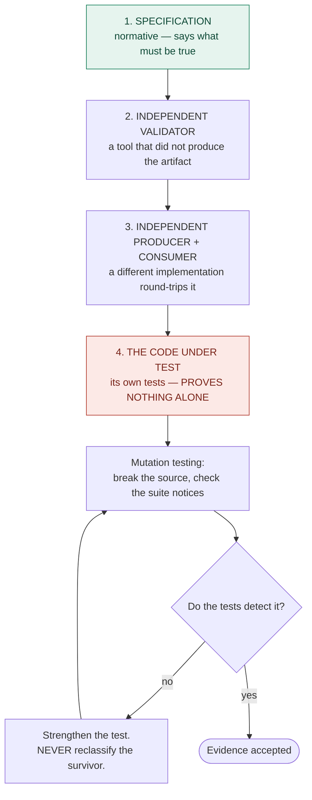

# Oracles: Where Truth Comes From

`references/tools-of-record.md` answers *which tool settles a claim*. This answers the
question underneath it: **when tools disagree, or when there is no tool, which source
wins?**

Two ordered hierarchies. Both are generated per project, because the sources differ
by stack — but the *shape* is universal.

## 1. Authority precedence — for questions of correctness

When the agent asks "what is the correct behaviour here?", it consults sources in
order and **cites the one that decided**.

| Rank | Class | Weight |
|---|---|---|
| 1 | Standards and normative specifications | **normative** |
| 2 | First-party vendor specification or documentation | **normative** |
| 3 | Machine-readable schema, type definitions, API contracts | **normative** |
| 4 | Accepted ADRs in this project | **binding** |
| 5 | This project's own technical specifications | **binding** |
| 6 | Observed behaviour of the reference implementation | evidence |
| 7 | Observed behaviour of a competing implementation | evidence |
| 8 | Community sources, blogs, forum answers | evidence, weakest |

**Ranks 1–3 are normative** — they say what must be true.
**Ranks 4–5 are binding** — this project has decided, and a change needs a new ADR.
**Ranks 6–8 are evidence only.** "Chrome does it this way" is an observation, not a
citation. It can inform a decision; it cannot settle one.

A decision recorded without naming its deciding rank is incomplete.

### Generated per profile

The generator fills the ranks from the detected stack. Examples:

| Stack | Rank 1–3 |
|---|---|
| Angular | angular.dev reference · framework source · TypeScript definitions |
| React | react.dev reference · React RFCs · type definitions |
| ASP.NET Core | .NET API reference · RFCs for HTTP/auth semantics · OpenAPI contract |
| Blazor / MAUI | Microsoft Learn reference · framework source · analyzer rule docs |
| Document formats | ECMA-376 / ISO-IEC 29500 · vendor open specs · XSD schemas |
| Web platform | WHATWG / W3C specs · MDN · WPT test suite |

## 2. Validation hierarchy — for questions of evidence

This is the deeper of the two, and the one most harnesses get wrong.



### Rank 4 is the point

**A system's own tests, passing, prove almost nothing about correctness.** They prove
the code does what its author believed — and the author was the same agent. Both can
be wrong in the same direction, and usually are.

This sharpens `evidence over assertion`. It is not enough that *a tool* produced the
evidence; it matters *whose* tool. Ordered by strength:

| | Oracle | Why it is stronger |
|---|---|---|
| Strongest | A specification | Independent of every implementation |
| | An independent validator | Different authors, different assumptions |
| | An independent producer/consumer round-trip | A second implementation must agree |
| Weakest | Your own test suite | Same author, same blind spots |

**Mutation testing is what rescues rank 4.** It cannot make your tests independent,
but it can prove they are *sensitive* — that breaking the source makes them fail. A
test suite with a high mutation score is still a rank-4 oracle, but a rank-4 oracle
that demonstrably notices things.

### Generated per profile

| Stack | Independent validator | Independent producer / consumer |
|---|---|---|
| Web UI | axe-core · W3C validator · Lighthouse | a real browser (Playwright) rendering it |
| REST API | OpenAPI schema validation · Semgrep | a generated client calling the live service |
| Document formats | Open XML SDK validator · PDF/A validator | a different library reading what you wrote |
| Data / persistence | DB constraints and schema checks | a raw SQL read-back, bypassing the ORM |
| .NET library | Roslyn analyzers · PublicApiAnalyzers | a consumer project compiling against it |
| Any | mutation testing (sensitivity, not independence) | — |

Where a stack has no independent oracle available, the harness **says so**:

```
ORACLE COVERAGE
  rank 1 specification        angular.dev reference (cited in knowledge/)
  rank 2 independent validator axe-core, tsc
  rank 3 independent round-trip NONE AVAILABLE
  rank 4 own test suite        vitest + mutation score 71
  -> correctness evidence here tops out at rank 2. State that in release notes.
```

Naming the ceiling is the honest move. A harness that implies rank-1 confidence from
rank-4 evidence is doing the same thing the agent was told not to.

## Two rules that fall out of this

1. **Cite the deciding rank.** Every decision in a spec, ADR, or task log names the
   source that settled it and its rank. "Because that's how it works" is not a
   citation.
2. **Never reclassify a surviving mutant.** When mutation testing finds a survivor,
   strengthen the test. Marking it *equivalent* or excluding it is the rank-4 version
   of lowering a threshold, and it is the single easiest way to make this whole system
   dishonest.
