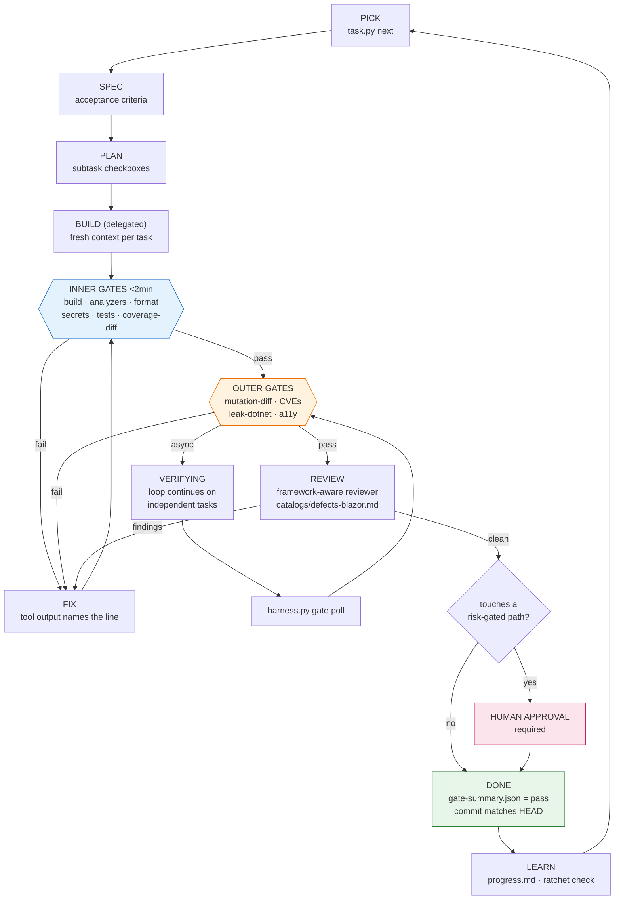

# The PROPOSE Stage

Most users do not know what to ask for. Asking them "do you want mutation
testing?" fails twice: they do not know what it is, and they have no basis to
judge. So the harness **detects, proposes, and asks for confirmation** — the user
learns by seeing the proposal, not by being quizzed.

Nothing is written to disk before the user approves. That is the rule.

## Output shape

### 1. What was detected, with the evidence for each conclusion

```
DETECTED
  Profile      dotnet-blazor  (score 28)
                 Microsoft.AspNetCore.Components.Web in src/Web/Web.csproj   +10
                 34 *.razor files                                             +8
                 src/Web/_Imports.razor                                       +6
                 Syncfusion.Blazor 25.1.35                                    +4
  Overlay      syncfusion  (Syncfusion.Blazor, Syncfusion.Blazor.Grid)
  Language     C# 12, .NET 8
  Tests        xUnit, 3 test projects, 412 tests
  Coverage     coverlet.collector present; current line rate 34%
  Analyzers    none configured  <-- gap
  Mutation     none configured  <-- gap
  Leak checks  none configured  <-- gap
  Git          yes, 1,847 commits, 3 hotspot files
  Harness      none (fresh install)
```

Show the evidence, not just the conclusion. A user who disagrees needs to see why
the scanner decided as it did — and the scanner is sometimes wrong.

### 2. The proposed loop, as a diagram



### 3. The gate table, with costs and gaps

```
TIER L1 (Diff-verified) proposed. You are currently L0.

INNER LANE  (runs after every subtask, budget 120s)
  gate              tool                 licence        threshold             status
  build             dotnet               MIT            exit == 0             ready
  analyzers         NetAnalyzers         MIT            errors == 0           NEEDS SETUP
  format            dotnet format        MIT            exit == 0             ready
  secrets           gitleaks             MIT            total == 0            NEEDS INSTALL
  tests             dotnet test          MIT            failed == 0           ready
  coverage-diff     coverlet             MIT            diffLineRate >= 0.70  ready
                                                        est. inner lane: ~75s

OUTER LANE  (once per task, budget 10800s)
  vulnerable-pkgs   dotnet list package  MIT            advisories == 0       ready
  syncfusion-license  generated script   n/a            exit == 0             will generate
  syncfusion-versions generated script   n/a            exit == 0             will generate
                                                        est. outer lane: ~4min

NOT PROPOSED AT L1 — available at L3
  mutation-diff     Stryker.NET          Apache-2.0     mutationScore >= 60
      Catches tests that execute code without asserting anything. This is the
      only gate that distinguishes a real test from `Assert.NotNull(result)`.
      Cost: ~25min on this solution with --since. Recommend adding once diff
      coverage holds above 80% for a few weeks.

  leak-dotnet       dotnet-gcdump        MIT            growthRatio <= 1.10
      Blazor's dominant leak is an undisposed DotNetObjectReference. No amount of
      code review finds it; a heap snapshot does. Needs a leak-probe script and a
      runnable app. Cost: ~3min.

  a11y              axe-core             MPL-2.0        failed == 0
      Requires Playwright. Cost: ~2min.
```

Naming what is *not* proposed, with a one-line rationale and a cost, is how the
user learns that mutation testing exists. This is the teaching surface.

### 4. Gaps and what the harness will do about them

```
GAPS
  1. No Roslyn analyzers configured.
     -> generate Directory.Build.props + .editorconfig with the escalation set
        (CA2000/CA2213 disposal, VSTHRD async, CA2100/CA5350 security as errors)
     -> 1,203 existing warnings, so the gate starts at errors-only and ratchets
     -> this replaces "the agent reviewed code quality" with a failing build

  2. Coverage is 34% overall.
     -> diff coverage at 70%, NOT global coverage. Legacy code is not held to a
        bar it can never meet; new code is held to a real one from today.
     -> ratchet floor recorded, so it cannot be lowered later

  3. gitleaks not installed.
     -> brew install gitleaks
     -> especially relevant here: a Syncfusion license key in source is both a
        leaked paid credential and, in a WASM project, shipped to every visitor

  4. No leak detection.
     -> deferred to L3. Blazor JS-interop leaks are the top runtime defect in
        this stack, so plan for it.
```

### 5. Knowledge and skills, honestly reported

```
KNOWLEDGE (fetched from first-party sources, cited in harness.lock)
  blazor-lifecycle      learn.microsoft.com/aspnet/core/blazor/components/lifecycle
  blazor-render-modes   learn.microsoft.com/aspnet/core/blazor/components/render-modes
  blazor-js-interop     learn.microsoft.com/aspnet/core/blazor/javascript-interoperability
  dotnet-ca-rules       learn.microsoft.com/dotnet/fundamentals/code-analysis/quality-rules
  syncfusion-blazor     blazor.syncfusion.com/documentation/introduction
  syncfusion-licensing  help.syncfusion.com/common/essential-studio/licensing

SKILLS (ai.syncfusion.com - official registry, 775 skills / 18 platforms)
  onboarding    syncfusion/agent-onboarding-skill            will install
  pack          syncfusion/blazor-ui-components-skills       72 skills available
  narrow install (Syncfusion rule: "install narrow skills, not full packs"):
      syncfusion-blazor-datagrid     <- SfGrid in Pages/Orders.razor
      syncfusion-blazor-charts       <- SfChart      (resolved from "chart")
      syncfusion-blazor-scheduler    <- SfSchedule   (resolved from "schedule")
      syncfusion-blazor-pdf-viewer   <- SfPdfViewer2
      syncfusion-dotnet-excel        <- ExcelEngine  (document SDK)
  5 of 72 skills. Every identifier validated against
  ai.syncfusion.com/blazor/inventory.txt - none guessed. Two needed resolving,
  which is why validation is not optional.

MCP
  sf-blazor-mcp   ->  Syncfusion.Blazor.MCP, will configure
                      key path: $HOME/.syncfusion/api-key.txt  <-- FILE NOT FOUND
                      Recorded as configured-but-unauthenticated until you create
                      it. Get a key at syncfusion.com/account/api-key. Note this
                      is NOT a product license key; both are needed.
  microsoft-docs  ->  not configured (optional; live .NET API lookup)
```

Never claim a skill or MCP is available when it is not. That is the failure the
harness exists to prevent, and it would be absurd to commit it during setup.

### 6. Files to be written

```
WILL CREATE
  .agent/harness.yaml                    contract: 9 gates, tier L1
  .agent/harness.lock                    resolved tools + ratchet floors
  .agent/instructions.md                 operating protocol
  .agent/project-context.md              architecture map from dotnet list reference
  .agent/tools/{task,harness,parsers,hyaml}.py
  .agent/adapters/{codestudio,claude-code,generic}.md
  .agent/knowledge/                      6 cited files
  .agent/agents/reviewer.md              Blazor-aware, works catalogs/defects-blazor.md
  .agent/tasks/index.json
  .agent/progress.md
  scripts/check-syncfusion-license.sh
  scripts/check-syncfusion-versions.sh
  Directory.Build.props                  MERGE (exists)
  .editorconfig                          MERGE (exists — 4 settings kept, 23 added)
  .codestudio/codestudio-instructions.md pointer (12 lines)
  CLAUDE.md                              pointer (12 lines)
  AGENTS.md                              pointer (12 lines)
  .gitignore                             += .agent/evidence/

WILL NOT CREATE
  no gate file for a tool that is not installed
  no knowledge file that could not be fetched and cited
  no placeholder documents

Proceed? [y / adjust tier / adjust gates / explain <gate>]
```

## Rules for this stage

1. **Nothing is written before approval.** Not one file.
2. **Show evidence for every detection**, so a wrong guess is visible.
3. **Name what is not proposed, with a cost and a reason.** This is the teaching.
4. **Never invent availability.** A missing tool, skill, or MCP is stated as
   missing.
5. **Estimate lane times.** A user with a three-hour suite needs to see the
   inner/outer split before agreeing to it.
6. **`explain <gate>` must work** — the user can drill into any gate and get its
   claim, tool, licence, cost, and rationale before deciding.
7. **Offer the tier explicitly.** Tier choice is the single biggest decision, and
   the table above makes its consequences legible.
